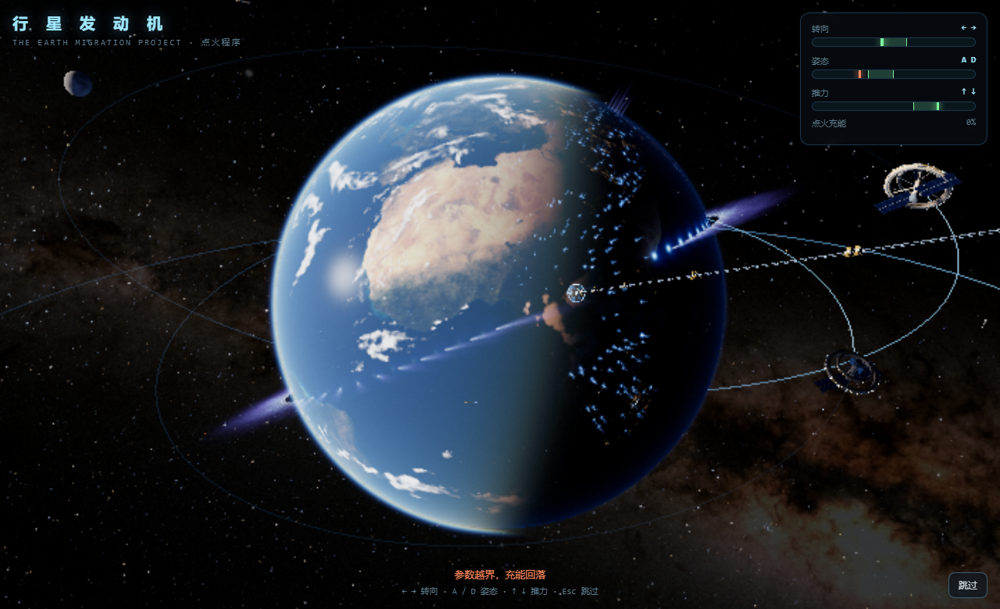
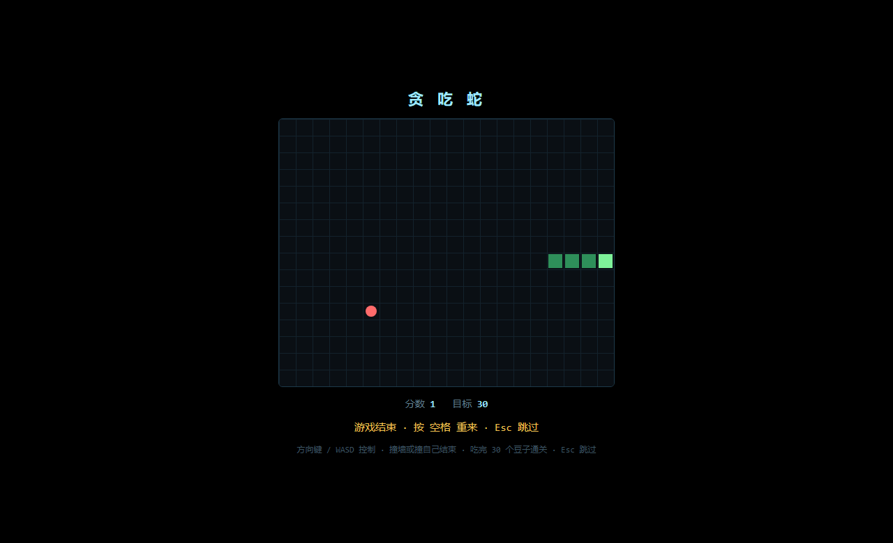
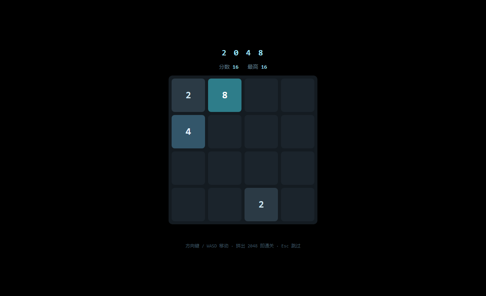
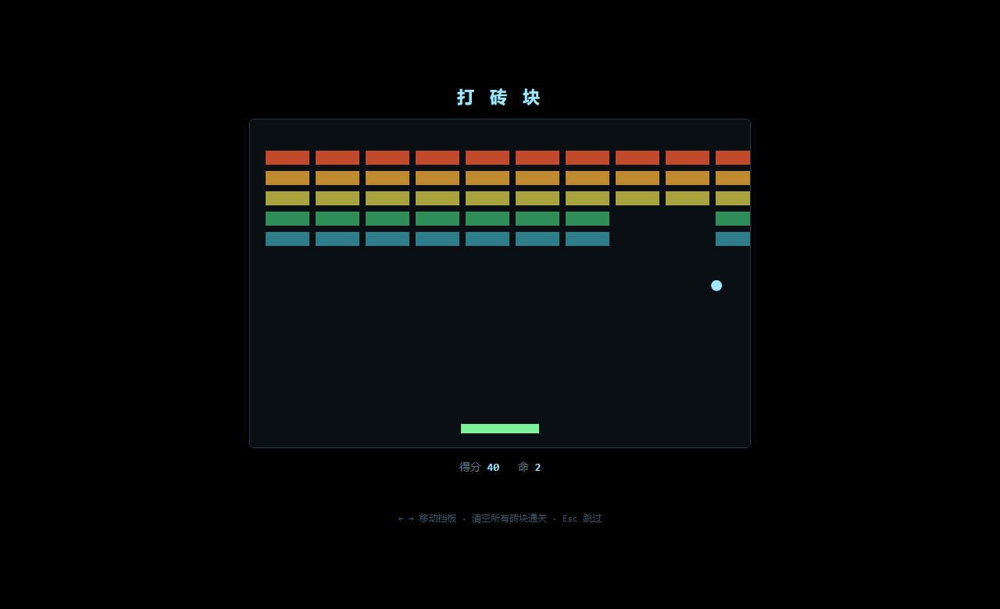
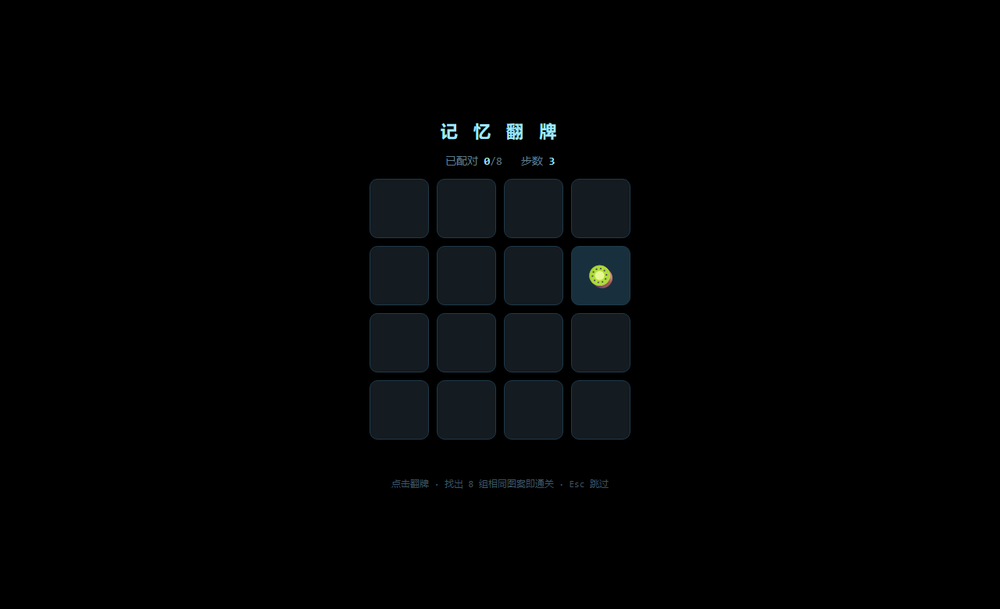
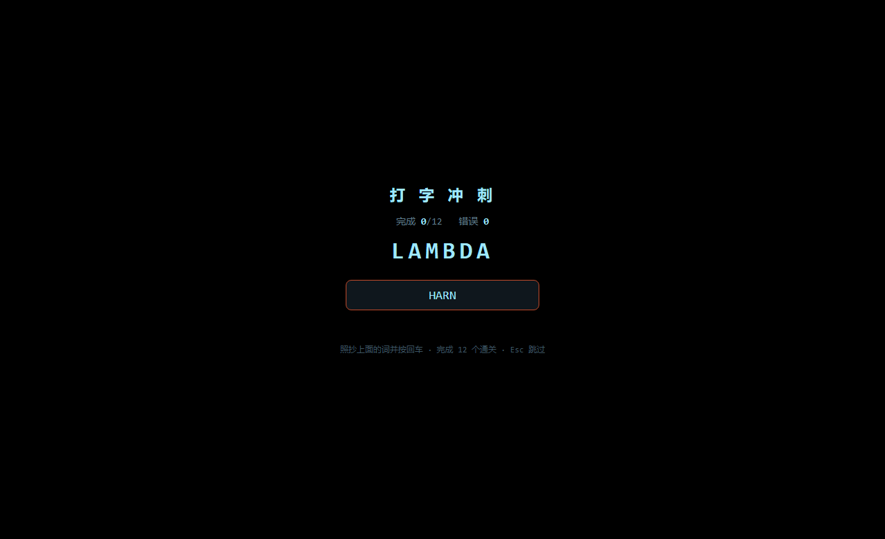

# dsh-boo550wt-animation

给 **DeepSeek Harness** 加一段开机动画：打开 DSH 时全屏展示一段内容，播完（或者按 `Esc`）才进入界面。

支持四种模式，全部可以在设置面板里改：

| 模式 | 内容 | 结束方式 |
| --- | --- | --- |
| `video` | 视频（默认：自带的 550W 风格动画，16.6 秒） | 播完自动进入 |
| `image` | 图片 | 显示 `durationMs` 后进入 |
| `web` | 网页（URL 或本地 HTML 文件） | 页面发完成消息，或超时 |
| `game` | 内置小游戏（六款） | 通关后进入 |

素材来源有两条路：**直接上传**（设置面板里点选或拖入文件，存进插件自己的目录），或**填绝对路径**指向你已有的文件。视频默认**带声音播放**。

## 内置小游戏

| 游戏 | 玩法 | 通关条件 |
| --- | --- | --- |
| 贪吃蛇 | 方向键 / WASD 吃豆子 | 吃满 30 个 |
| 2048 | 方向键 / WASD 合并数字 | 拼出 2048 |
| 打砖块 | ← → 移动挡板接球 | 清空全部砖块 |
| 记忆翻牌 | 点击翻牌配对 | 8 组全部配对 |
| 打字冲刺 | 照抄单词回车提交 | 完成 12 个 |
| **行星发动机 3D**（流浪地球） | ← → / A D / ↑ ↓ 稳住三路参数 | 三路参数同时在绿区保持 3 秒 |

**跳过永远可用**：按 `Esc`，或点右下角的「跳过」按钮。小游戏跑在 iframe 里会吃掉键盘，所以每一款游戏都内置了把 Esc 转发给宿主页面的中继；右下角那个是真正的按钮，可以点。

### 行星发动机 3D 是从哪来的

这一款不是手画的 canvas，而是接入了开源项目 **[oxomkbk/earth-migration](https://github.com/oxomkbk/earth-migration)**（MIT 协议）——一个基于 three.js 的电影级 WebGL 场景：真实的地球贴图、云层、行星发动机群、赤道转向阵列、太空电梯、银河背景。整套 three.js、贴图和模型都**内置在插件里**（`vendor/earth-migration/`，约 25 MB），不联网、不依赖 CDN。

原项目是个"观影 + 自由探索"的体验，这里保留了它的场景，在上面叠了一层点火玩法：三路参数压进绿区撑满 3 秒即点火成功。进入时会自动切到它的自由探索模式。

```
打开 DSH  ─▶  黑底 + 动画  ─▶  播完 / 通关 / 按 Esc  ─▶  淡出  ─▶  正常界面
```

关键在于**交接时机**：遮罩在 DSH 结算「启动就绪」之前就已经挂上去了，所以应用是在遮罩底下正常渲染的，等动画结束再把界面让出来 —— 而不是先看到界面再盖一层。

## 效果预览

自带素材的分镜（2.0s / 6.0s / 12.0s / 15.0s）：


真实播放时的样子 —— 画面铺满窗口，右下角在 4 秒后浮现跳过提示：


### 六款内置小游戏

**行星发动机 3D**（流浪地球）—— 真实地球贴图、赤道发动机群、太空电梯、银河背景：



| 贪吃蛇 | 2048 |
| --- | --- |
|  |  |

| 打砖块 | 记忆翻牌 |
| --- | --- |
|  |  |

**打字冲刺** —— 照抄单词回车提交：



> 截图都是从真实运行里截的，不是效果图：经插件的路由服务页面，用 Chromium 采集 WebGL 与 DOM 画面（`tools/browser-check.mjs --shot=`、`tools/stills.mjs`）。

## 怎么用

### 1. 装

DSH 的插件用它自己的 CLI 安装（`desktop` 是保留 profile，由 Electron 应用托管）：

```powershell
# 先拿到仓库
git clone https://github.com/456erddgr/dsh-boo550wt-animation.git

# 再用 DSH 自带的 CLI 装进 desktop profile
$env:ELECTRON_RUN_AS_NODE = '1'
& "<你的安装目录>\DeepSeek Harness.exe" --expose-internals `
  "<你的安装目录>\resources\app.asar\dsh\node_modules\@deepseek-ai\dsh-desktop-host\lib\cli.js" `
  plugin --profile desktop add "<clone 出来的目录>"
```

`<你的安装目录>` 默认是 `%LOCALAPPDATA%\Programs\DeepSeek Harness`。

这条命令会做三件事：加一条 `link:` 依赖、在 `node_modules` 里建好入口、把 bundle 追加进 `dsh.profile.bundles`。

> `add` 底层是 pnpm，所以也接受 git 形式：
> `plugin --profile desktop add github:456erddgr/dsh-boo550wt-animation`

### 2. 重启 DSH

**必须重启。** Host 半侧的代码只在 DSH 启动时被 import 一次，热更新不会加载它。设置面板的修改在重启后生效。

### 3. 在设置里改开机动画

重启后，打开 **设置 → 开机动画**，可以改：

- **类型**：视频 / 图片 / 网页 / 小游戏（四张卡片直接点选）
- **小游戏**：六款游戏的按钮网格，点一下切换
- **素材**：在虚线框里**点击选择或拖入文件**，上传后自动选中；也能看到已上传列表、点一下切换、点 × 删除
- **路径兜底**：不想上传就填绝对路径，指向你已有的文件
- **网页地址**：填 URL，或本地 HTML 文件绝对路径
- **播放声音**：视频模式的开关，默认开（浏览器拒绝自动播放时自动退回静音并提示点一下开启声音）
- **显示时长 / 硬上限 / 淡出 / 提示延迟 / 跳过提示文字**
- **预览**：用当前选择弹一个临时遮罩看一眼，不改配置、不重启
- **恢复默认**：一键还原所有参数（不会删已上传的素材）

上传的文件存在 `~/.dsh/boot-animation-uploads/`，设置存在 `~/.dsh/boot-animation-settings.json`。改完点保存，下次启动生效。

上传的几个细节（照 wallpaper-engine 的做法）：

- **流式落盘**：边收边写 `.tmp`，完成后 `rename` 发布，不会把整个文件缓冲进内存（上限 512 MB）
- **内容去重**：同一份文件再传一次不会堆副本，直接返回已有条目
- **中途断开清理**：关标签页/断网会清掉 `.tmp`，不留残file
- **路径穿越防护**：只认 `up-` 开头的自生成文件名，`../` 之类的请求一律 404

### 4. 跳过 / 卸载

- **跳过**：随时按 `Esc`，或点右下角「跳过」按钮。小游戏和网页模式下按钮**立即出现**（它们的 iframe 会吃掉键盘，按钮是唯一可靠出口）；视频模式下按钮延迟 4 秒出现，免得打断片头。
- **声音**：视频默认**带声音**播放；如果引擎拒绝对自动播放，会自动退回静音并在角上提示「点击开启声音」，点一下即可恢复。
- **兜底**：内容解不开时，遮罩 0.9 秒后放弃；任何情况下都有 `maxSeconds` 硬上限。
- **卸载**：

```powershell
plugin --profile desktop remove dsh-boo550wt-animation
```

---

## 原理

这个插件是 **Host-only + 浏览器设置面板**：

1. **`webserver/index-inject` 注入行** —— 一条 `style`、一条 body `script`。DSH 会把注入行应用到页面上，时机**早于** `__DSH_BOOT_READY__` 结算、也早于客户端模块加载器启动，这正是遮罩能成为屏幕上第一个东西的原因。脚本启动时拉一次 `/config`，用你最新保存的设置来决定显示什么。
2. **`/boot-animation` 下的路由** —— 带 `Range`、`HEAD`、`416` 处理，交给浏览器自己的媒体栈去解码；配置、图片、视频、网页、小游戏、上传的素材都是经同一套路由提供的。
3. **设置面板** —— 通过 `settings.section` slot 挂进 DSH 设置界面（和 dsh-better-sidebar 等插件同一套契约），读写同一份 `/config`，并管理上传目录。

客户端脚本是把一个真函数 `toString()` 出来的（`lib/inject.js`），所以注入的 JavaScript 是当普通源码被解析和检查的，也保证不含尖括号和 `</script`。

## 自检工具

| 命令 | 能证明什么 |
| --- | --- |
| `node tools/selftest.mjs` | 配置读写、注入行、Range 服务（视频+图片）、六款游戏页面与中继、上传/去重/删除/穿越防护、路由与状态码 —— 44 项 |
| `node tools/browser-check.mjs` | 真实 Chromium 里：视频（含**声音未被静音**）/图片/网页/小游戏四种模式、**跳过按钮可点、iframe 内 Esc 能转发**、六款游戏逐个加载 —— 19 项 |
| `ELECTRON_RUN_AS_NODE=1 <DeepSeek Harness.exe> --expose-internals tools/verify-install.mjs` | 用 DSH 自己的 profile 加载器验证：bundle 被组合进去了（loaded 而不是 skipped），Host 入口能解析 |

---

## 说明与限制

- 视频的 `moov` atom 在文件尾部，所以首帧之前浏览器要把整个 12 MB 抓下来；走 loopback 基本无感。素材如果真的变大，用 `-movflags +faststart` 重新封装就能消掉这个等待。
- **声音**：视频默认带声播放（Electron 允许无手势自动播放）。Web 端浏览器可能拒绝有声自动播放，此时插件自动退回静音并在角上提示，点一下即可带声重来。也可在设置里直接关掉「播放声音」。
- 跳过和硬上限是刻意的设计：开机动画**永远**不应该有能力锁死窗口。
- 遮罩追加到 `body`，从不碰 `#root`，所以 React 的挂载点不受影响；拆除时它会连同自己的监听器和定时器一起收干净。
- `web` 模式加载的是**你给的**网页：如果你在设置里填了外网 URL，开机时 DSH 会去访问它。这是有意为之的能力，不是默认行为（默认是视频）。
- 上传目录没有配额限制，超大视频会占磁盘；不用了请在设置面板里点 × 删除。
- `assets/boot.mp4` 与本仓库的示例素材只作 550W 风味参考，与《流浪地球》官方无关。如果要公开分发本仓库，请自行确认你对该素材拥有相应权利。
