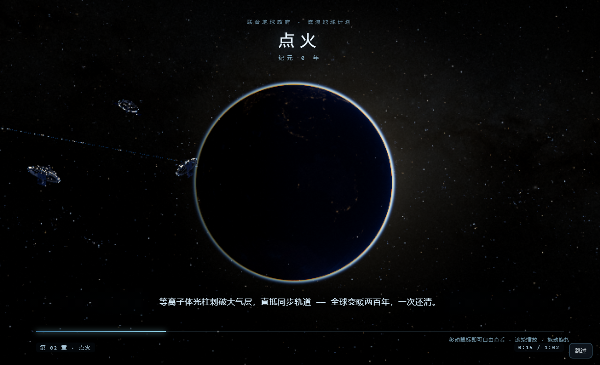
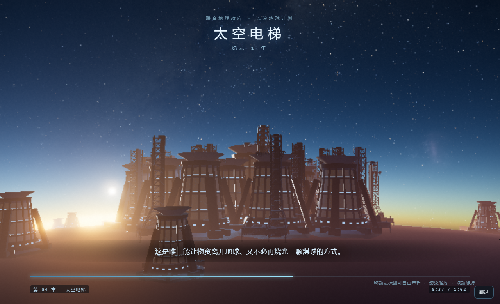
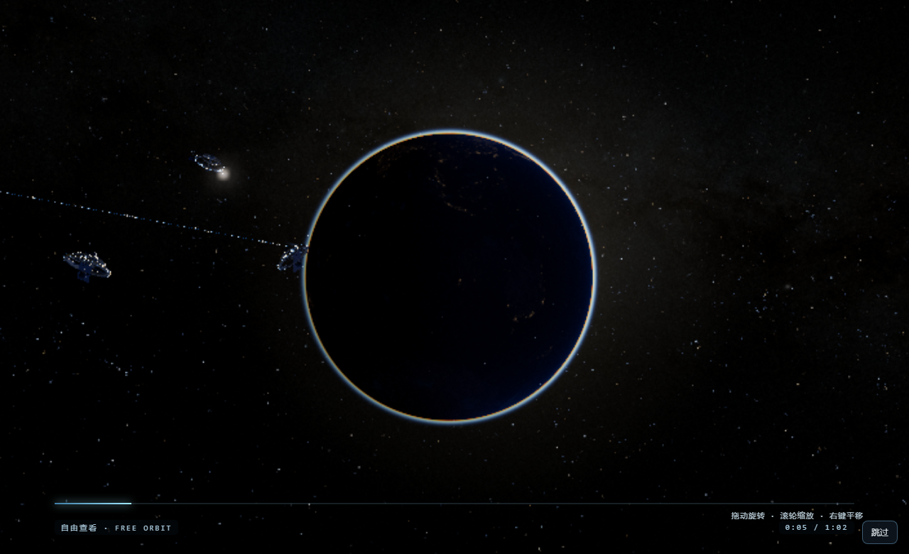
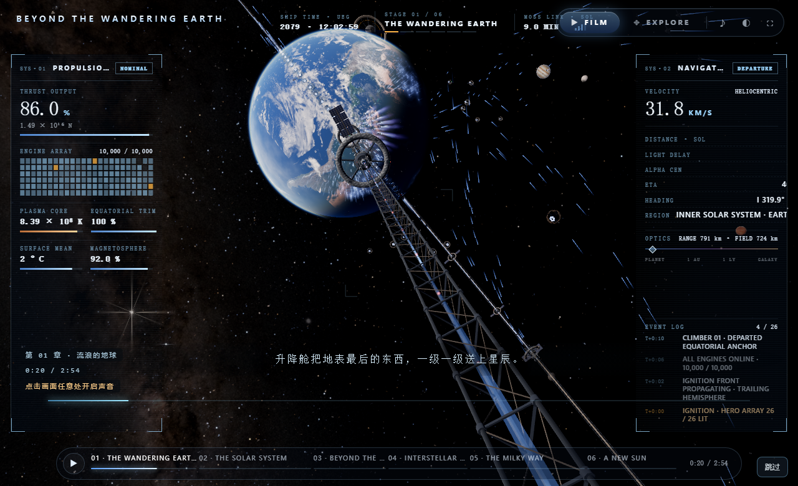
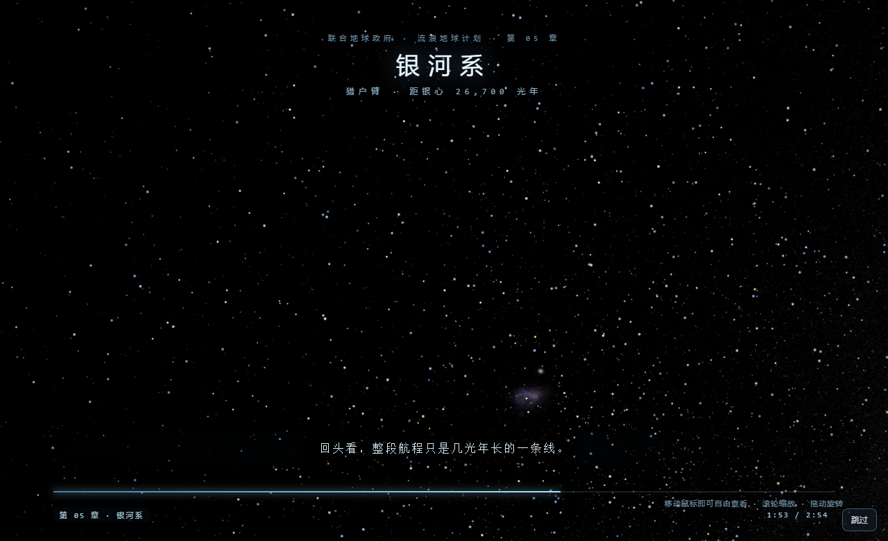

# dsh-boo550wt-animation

给 **DeepSeek Harness** 加一段开机动画：打开 DSH 时全屏展示一段内容，播完（或者按 `Esc`）才进入界面。

支持四种模式，全部可以在设置面板里改：

| 模式 | 内容 | 结束方式 |
| --- | --- | --- |
| `video` | 视频（默认：自带的 550W 风格动画，16.6 秒） | 播完自动进入 |
| `image` | 图片 | 显示 `durationMs` 后进入 |
| `web` | 网页（URL 或本地 HTML 文件） | 页面发完成消息，或超时 |
| `game` | 内置内容（两部流浪地球 3D 讲解 + 五款小游戏） | 通关 / 讲完自动进入 |

素材来源有两条路：**直接上传**（设置面板里点选或拖入文件，存进插件自己的目录），或**填绝对路径**指向你已有的文件。视频默认**带声音播放**。

## 内置内容

| 内容 | 玩法 | 结束方式 |
| --- | --- | --- |
| 贪吃蛇 | 方向键 / WASD 吃豆子 | 吃满 30 个 |
| 2048 | 方向键 / WASD 合并数字 | 拼出 2048 |
| 打砖块 | ← → 移动挡板接球 | 清空全部砖块 |
| 记忆翻牌 | 点击翻牌配对 | 8 组全部配对 |
| 打字冲刺 | 照抄单词回车提交 | 完成 12 个 |
| **流浪地球 · 行星发动机计划**（3D 第一部） | 自动播放讲解运镜，鼠标接管自由查看 | 讲完自动进入，或随时 Esc |
| **流浪地球 2.0 · 从发动机到银河**（3D 第二部） | 同一套底座的六章长片，可从 100 km 拉到银河 | 讲完自动进入，或随时 Esc |

**跳过永远可用**：按 `Esc`，或点右下角的「跳过」按钮。内容跑在 iframe 里会吃掉键盘，所以每一项都内置了把 Esc 转发给宿主页面的中继；右下角那个是真正的按钮，可以点。

### 流浪地球讲解（3D，两部）

接入开源项目 **[oxomkbk/earth-migration](https://github.com/oxomkbk/earth-migration)**（MIT 协议）——基于 three.js r160 的电影级 WebGL 场景：真实地球贴图、云层、行星发动机群、赤道转向阵列、太空电梯、同步轨道环、护航舰队、太阳系、星际空间与银河系。整套 three.js、贴图、模型和行星数据库**内置在插件里**（`vendor/earth-migration/`，约 34 MB），不联网、不依赖 CDN。

内置**两条** 3D 讲解，都能在设置里选：

| 名称 | 内容 | 时长 |
| --- | --- | --- |
| 流浪地球 · 行星发动机计划（第一部） | 地球轨道尺度的六幕：点火、刹车、太空电梯、木星弹弓、长夜 | 1 分 02 秒 |
| 流浪地球 2.0 · 从发动机到银河（第二部） | 从 100 km 一路拉到 10 万光年：行星 → 太阳系 → 日球层顶 → 星际 → 银河 → 半人马座 α | 2 分 54 秒 |

**第一部** 开机时**自动播放一段 62 秒的中文讲解**，六个章节依次推进，镜头由原项目的导演系统驱动：

| 章节 | 时间轴 | 讲什么 |
| --- | --- | --- |
| 01 太阳的黄昏 | 2061 | 太阳步入晚年，联合政府决定带走地球 |
| 02 点火 | 纪元 0 年 | 一万两千米高的发动机，一万两千座同时点火 |
| 03 让地球自转停下 | 纪元 0 年 · 第三天 | 赤道转向发动机让 4.5 亿年来第一次停转 |
| 04 太空电梯 | 纪元 1 年 | 三万六千公里到同步轨道，终点天枢中枢 |
| 05 木星引力弹弓 | 纪元 17 年 | 借木星引力完成最后一脚 |
| 06 两千年长夜 | 纪元 2500 年 | 地表封冻，目标四光年外的比邻星 |

**随时接管**：动一下鼠标（或触摸、滚轮）就切到自由查看 —— `OrbitControls` 已配好阻尼、缩放和光标跟随缩放，可以**拖动转圈、滚轮放大缩小、右键平移**。想回到讲解只需重启。右下角始终有「跳过」。

**第二部** 是同一个底座上的另一部片子：不再只停在地球轨道，一路拉到银河系。六章：

| 章节 | 时间轴 | 讲什么 |
| --- | --- | --- |
| 01 流浪的地球 | 2078 年 | 一万台聚变发动机点火的全球点火序列 |
| 02 太阳系 | 2079—2093 年 | 穿过行星轨道，木星弹弓、土星环 |
| 03 越过外行星 | 2101—2156 年 | 海王星、柯伊伯带、日球层顶 |
| 04 星际航行 | 2160—2580 年 | 星际介质里的弓形激波，一百代人的冰封天空 |
| 05 银河系 | — | 从几光年的航线拉到 10 万光年的银河系 |
| 06 新的太阳 | 4578 年 | 半人马座 α，冰原上第一缕日光 |

它自带三层对数尺度（行星 63.7 km → 天文单位 → 光年），自由查看时**滚动就是穿越尺度**，可以从 100 km 一直拉到银河系；25 个目的地可以点选飞抵。

第二部的**状态栏是原项目那套**，一条都没删：左侧 `PROPULSION`（推力、发动机阵列矩阵、等离子体核心、赤道配平、地表均温、磁层）、右侧 `NAVIGATION`（速度、对数航迹图、距离/光行时/到达时间/航向/区域、光学、事件日志）、顶部 `MISSION STRIP`（船时、阶段/章节进度、链路延迟），以及底部章节条与右下角模式按钮。

**入口与出口**：讲解进行中点右上 `EXPLORE` 或按 `F` 才切自由查看；回到讲解点 `FILM` 或再按 `F`。**鼠标移动不会打断讲解** —— 早先版本是「一动鼠标就切自由相机」，那会把解说当场吞掉，已经改掉。

**音乐**：第二部不再用上游的程序化合成配乐，改为播放内置的一首录音（`assets/audio/theme.m4a`，7 分 05 秒，循环，音量压在解说之下）。Electron 允许无手势自动播放；普通浏览器若拒绝，页面会提示「点击画面任意处开启声音」，点一下即恢复。

字幕与进度用**真实时间**驱动，而不是帧累计：渲染被节流或机器较慢时，讲解不会变成慢放。

```
打开 DSH  ─▶  黑底 + 动画  ─▶  播完 / 讲完 / 按 Esc  ─▶  淡出  ─▶  正常界面
```

关键在于**交接时机**：遮罩在 DSH 结算「启动就绪」之前就已经挂上去了，所以应用是在遮罩底下正常渲染的，等动画结束再把界面让出来 —— 而不是先看到界面再盖一层。

## 效果预览

自带素材的分镜（2.0s / 6.0s / 12.0s / 15.0s）：


真实播放时的样子 —— 画面铺满窗口，右下角在 4 秒后浮现跳过提示：


### 流浪地球讲解（自动运镜 + 自由查看）

开机自动播放第一段讲解 —— 第二章「点火」，字幕正在说一万两千座发动机同时点燃：



第四章「太空电梯」，镜头贴着发动机基座群仰拍，字幕讲天枢中枢空间站：



动一下鼠标就交给自由查看 —— 地球夜景、太阳、护航舰队，可以拖动转圈、滚轮缩放：



**第二部** 的开场：全球点火序列，一万台发动机在背光半球逐个亮起 —— 左侧 `PROPULSION`、右侧 `NAVIGATION`、顶部 `MISSION STRIP`、底部章节条，都是原项目那整套状态栏：



第五章拉到银河系尺度 —— 回头再看，整段航程只是几光年长的一条线：



> 这几张图都是修完之后重拍的。早先第一部拍出来是「一盏灯照在黑球上」、发动机只剩剪影 —— 原因不是模型不行：目录型场景到达时少了末尾斜杠，页面里所有 `assets/...` 相对路径都解析高了一级，**25 个贴图与模型全部 404**。现在 `/game/<id>` 会 308 跳到 `/game/<id>/`，云层、大陆、夜景灯光、发动机光柱才是它真实的样子。

### 五款小游戏

| 贪吃蛇 | 2048 |
| --- | --- |
|  |  |

| 打砖块 | 记忆翻牌 |
| --- | --- |
|  |  |

**打字冲刺** —— 照抄单词回车提交：


> 截图都是从真实运行里截的，不是效果图：经插件的路由服务页面，用 Chromium 采集 WebGL 与 DOM 画面（`tools/browser-check.mjs --shot=`、`tools/screenshots.mjs`）。

## 怎么用

### 1. 装

DSH 的插件用它自己的 CLI 安装（`desktop` 是保留 profile，由 Electron 应用托管）：

```powershell
# 先拿到仓库
git clone https://github.com/456erddgr/dsh-boo550wt-animation.git

# 再用 DSH 自带的 CLI 装进 desktop profile
$env:ELECTRON_RUN_AS_NODE = '1'
& "<你的安装目录>\DeepSeek Harness.exe" --expose-internals `
  "<你的安装目录>\resources\app.asar\dsh\node_modules\@deepseek-ai\dsh-desktop-host\lib\cli.js" `
  plugin --profile desktop add "<clone 出来的目录>"
```

`<你的安装目录>` 默认是 `%LOCALAPPDATA%\Programs\DeepSeek Harness`。

这条命令会做三件事：加一条 `link:` 依赖、在 `node_modules` 里建好入口、把 bundle 追加进 `dsh.profile.bundles`。

> `add` 底层是 pnpm，所以也接受 git 形式：
> `plugin --profile desktop add github:456erddgr/dsh-boo550wt-animation`

### 2. 重启 DSH

**必须重启。** Host 半侧的代码只在 DSH 启动时被 import 一次，热更新不会加载它。设置面板的修改在重启后生效。

### 3. 在设置里改开机动画

重启后，打开 **设置 → 开机动画**，可以改：

- **类型**：视频 / 图片 / 网页 / 内置 3D（四张卡片直接点选）
- **内置 3D**：七项内容的按钮网格 —— 两部流浪地球 3D 讲解 + 五款小游戏，点一下切换
- **素材**：在虚线框里**点击选择或拖入文件**，上传后自动选中；也能看到已上传列表、点一下切换、点 × 删除
- **路径兜底**：不想上传就填绝对路径，指向你已有的文件
- **网页地址**：填 URL，或本地 HTML 文件绝对路径
- **播放声音**：视频模式的开关，默认开（浏览器拒绝自动播放时自动退回静音并提示点一下开启声音）
- **显示时长 / 硬上限 / 淡出 / 提示延迟 / 跳过提示文字**
- **全屏预览**：**不用保存、不用重启**，直接把屏上这份设置拿去跑真正的开机遮罩 —— 视频、图片、网页、小游戏、两部 3D 讲解都能预览；按 Esc 或点「跳过」结束，不改配置
- **恢复默认**：一键还原所有参数（不会删已上传的素材）

全屏预览走的是一条自己的路由 `/boot-animation/preview?c=<设置>`：它由 Host 用与真实开机**同一份**注入脚本、同一份样式、同一套媒体路由渲染成文档，只把「要显示什么」换成 URL 里带来的那份设置。所以预览看到的就是开机时会看到的，而不是面板里仿造的一个近似品。

上传的文件存在 `~/.dsh/boot-animation-uploads/`，设置存在 `~/.dsh/boot-animation-settings.json`。改完点保存，下次启动生效。

上传的几个细节（照 wallpaper-engine 的做法）：

- **流式落盘**：边收边写 `.tmp`，完成后 `rename` 发布，不会把整个文件缓冲进内存（上限 512 MB）
- **内容去重**：同一份文件再传一次不会堆副本，直接返回已有条目
- **中途断开清理**：关标签页/断网会清掉 `.tmp`，不留残file
- **路径穿越防护**：只认 `up-` 开头的自生成文件名，`../` 之类的请求一律 404

### 4. 跳过 / 卸载

- **跳过**：随时按 `Esc`，或点右下角「跳过」按钮。小游戏和网页模式下按钮**立即出现**（它们的 iframe 会吃掉键盘，按钮是唯一可靠出口）；视频模式下按钮延迟 4 秒出现，免得打断片头。
- **声音**：视频默认**带声音**播放；如果引擎拒绝对自动播放，会自动退回静音并在角上提示「点击开启声音」，点一下即可恢复。
- **兜底**：内容解不开时，遮罩 0.9 秒后放弃；任何情况下都有 `maxSeconds` 硬上限。
- **卸载**：

```powershell
plugin --profile desktop remove dsh-boo550wt-animation
```

---

## 原理

这个插件是 **Host-only + 浏览器设置面板**：

1. **`webserver/index-inject` 注入行** —— 一条 `style`、一条 body `script`。DSH 会把注入行应用到页面上，时机**早于** `__DSH_BOOT_READY__` 结算、也早于客户端模块加载器启动，这正是遮罩能成为屏幕上第一个东西的原因。脚本启动时拉一次 `/config`，用你最新保存的设置来决定显示什么。
2. **`/boot-animation` 下的路由** —— 带 `Range`、`HEAD`、`416` 处理，交给浏览器自己的媒体栈去解码；配置、图片、视频、网页、内置内容、上传的素材都是经同一套路由提供的。
3. **`/boot-animation/preview` 路由** —— 设置面板的「全屏预览」用的就是这个。Host 用同一个 `bootScript()`、同一份 `BOOT_STYLE` 渲染出一个独立文档，把 URL 里带来的那份未保存设置作为种子（`preview: true` 让它跳过 `/config`，播完回一条 `__bootPreviewDone` 让面板收框）。**它不会写设置文件。**
4. **设置面板** —— 通过 `settings.section` slot 挂进 DSH 设置界面（和 dsh-better-sidebar 等插件同一套契约），读写同一份 `/config`，并管理上传目录。

客户端脚本是把一个真函数 `toString()` 出来的（`lib/inject.js`），所以注入的 JavaScript 是当普通源码被解析和检查的，也保证不含尖括号和 `</script`。

## 自检工具

| 命令 | 能证明什么 |
| --- | --- |
| `node tools/selftest.mjs` | 配置读写、注入行、Range 服务（视频+图片）、七项内置内容与中继、目录游戏的末尾斜杠跳转、贴图真实可达、预览路由不落盘、上传/去重/删除/穿越防护、路由与状态码 —— 53 项 |
| `node tools/browser-check.mjs` | 真实 Chromium 里：视频（含**声音未被静音**）/图片/网页/内置 3D 四种模式、**跳过按钮可点、iframe 内 Esc 能转发**、七项内容逐个加载（含两部 3D 场景）、**预览路由用 URL 里的设置挂载真遮罩并回报完成** —— 21 项 |
| `node tools/screenshots.mjs <绝对路径>/lib/games.js <输出目录>` | 经插件真实路由逐项截图，含两部 3D 场景；每张都开一个干净浏览器，避免 WebGL 上下文串味 |
| `ELECTRON_RUN_AS_NODE=1 <DeepSeek Harness.exe> --expose-internals tools/verify-install.mjs` | 用 DSH 自己的 profile 加载器验证：bundle 被组合进去了（loaded 而不是 skipped），Host 入口能解析 |

---

## 说明与限制

- 视频的 `moov` atom 在文件尾部，所以首帧之前浏览器要把整个 12 MB 抓下来；走 loopback 基本无感。素材如果真的变大，用 `-movflags +faststart` 重新封装就能消掉这个等待。
- **声音**：视频默认带声播放（Electron 允许无手势自动播放）。Web 端浏览器可能拒绝有声自动播放，此时插件自动退回静音并在角上提示，点一下即可带声重来。也可在设置里直接关掉「播放声音」。
- 跳过和硬上限是刻意的设计：开机动画**永远**不应该有能力锁死窗口。
- 遮罩追加到 `body`，从不碰 `#root`，所以 React 的挂载点不受影响；拆除时它会连同自己的监听器和定时器一起收干净。
- `web` 模式加载的是**你给的**网页：如果你在设置里填了外网 URL，开机时 DSH 会去访问它。这是有意为之的能力，不是默认行为（默认是视频）。
- 上传目录没有配额限制，超大视频会占磁盘；不用了请在设置面板里点 × 删除。
- `assets/boot.mp4` 与本仓库的示例素材只作 550W 风味参考，与《流浪地球》官方无关。如果要公开分发本仓库，请自行确认你对该素材拥有相应权利。
