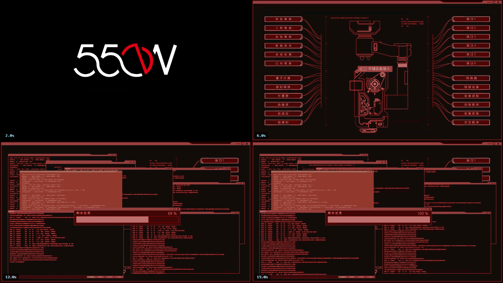
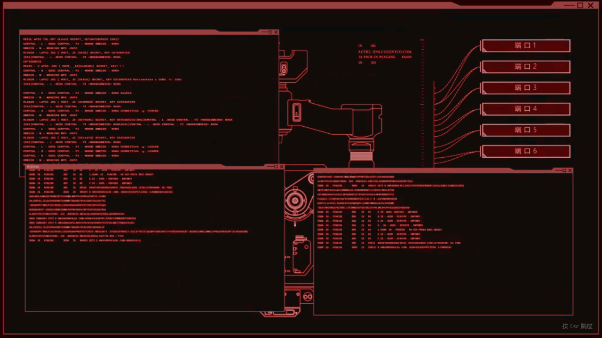

# dsh-boo550wt-animation

给 **DeepSeek Harness** 加一段开机动画：打开 DSH 时全屏播放一段视频，播完（或者按 `Esc`）才进入界面。

> 自带素材 `assets/boot.mp4` 是一段 **550W 风格**的启动动画 —— 16.6 秒、1024×576、H.264 + AAC、12.1 MB。

```
打开 DSH  ─▶  黑底 + 视频  ─▶  播完 / 按 Esc  ─▶  淡出  ─▶  正常界面
```

关键在于**交接时机**：遮罩在 DSH 结算「启动就绪」之前就已经挂上去了，所以应用是在遮罩底下正常渲染的，等动画结束再把界面让出来 —— 而不是先看到界面再盖一层。

## 效果预览

自带素材的分镜（2.0s / 6.0s / 12.0s / 15.0s）：



真实播放时的样子 —— 画面铺满窗口，右下角在 4 秒后浮现跳过提示：



> 两张图都是从 `assets/boot.mp4` 里实拍的，不是效果图：用真实 Chromium 媒体栈经插件的 Range 路由解码后截帧生成（`tools/stills.mjs` 与 `tools/browser-check.mjs --shot=`）。

---

## 怎么用

### 1. 装

DSH 的插件用它自己的 CLI 安装（`desktop` 是保留 profile，由 Electron 应用托管）：

```powershell
# 先拿到仓库
git clone https://github.com/456erddgr/dsh-boo550wt-animation.git

# 再用 DSH 自带的 CLI 装进 desktop profile
$env:ELECTRON_RUN_AS_NODE = '1'
& "<你的安装目录>\DeepSeek Harness.exe" --expose-internals `
  "<你的安装目录>\resources\app.asar\dsh\node_modules\@deepseek-ai\dsh-desktop-host\lib\cli.js" `
  plugin --profile desktop add "<clone 出来的目录>"
```

`<你的安装目录>` 默认是 `%LOCALAPPDATA%\Programs\DeepSeek Harness`。

这条命令会做三件事：加一条 `link:` 依赖、在 `node_modules` 里建好入口、把 bundle 追加进 `dsh.profile.bundles`。

> `add` 底层是 pnpm，所以也接受 git 形式：
> `plugin --profile desktop add github:456erddgr/dsh-boo550wt-animation`

### 2. 重启 DSH

**必须重启。** Host 半侧的代码只在 DSH 启动时被 import 一次，热更新不会加载它。

重启后可以自查 —— 浏览器打开这个地址，返回 JSON 就说明 Host 半侧已经起来了：

```
http://127.0.0.1:19387/boot-animation/state
```

### 3. 换视频 / 调参数

不用改代码，在 profile 的 patch 层里按行 id 覆盖配置即可：

```yaml
- id: dsh-boo550wt-animation
  config:
    videoPath: "E:/成品/别的视频.mp4"   # 留空则用自带的 assets/boot.mp4
    zIndex: 2147483000
    fadeMs: 380
```

| 字段 | 默认值 | 含义 |
| --- | --- | --- |
| `enabled` | `true` | 设 `false` 可以临时停用而不卸载 |
| `videoPath` | `""` | 换成别的视频；留空 = 用自带素材 |
| `zIndex` | `2147483000` | 遮罩层级 |
| `maxSeconds` | `120` | 硬上限，卡死的视频也绝不会锁住窗口 |
| `graceMs` | `1500` | 上报时长之外再宽限多久才触发上限 |
| `fadeMs` | `380` | 交接时的淡出时长 |
| `hintDelayMs` | `4000` | 多久之后出现跳过提示 |
| `skipHint` | `按 Esc 跳过` | 提示文字 |
| `silentHint` | `按 Esc 跳过 · 点击开启声音` | 被降级成静音时显示 |
| `blockedHint` | `点击以播放开机动画` | 自动播放被彻底拦截时显示 |
| `errorHint` | `开机动画不可用` | 视频解不开时显示 |

### 4. 跳过 / 卸载

- **跳过**：随时按 `Esc`。如果浏览器不给出声自动播放，插件会先退回静音并在角上说明，同时装一个点击/按键处理器，让你点一下就能带着声音重来。视频彻底解不开时，遮罩 0.9 秒后放弃，正常界面照常出现。
- **卸载**：

```powershell
plugin --profile desktop remove dsh-boo550wt-animation
```

---

## 原理

这个插件是 **Host-only**（只有 `lib/index.js`），没有 client 模块，也没有构建步骤。它只用 profile 自带的 webserver 的两个机制：

1. **`webserver/index-inject` 注入行** —— 一条 `style`、一条 body `script`。DSH 会把注入行应用到页面上，时机**早于** `__DSH_BOOT_READY__` 结算、也早于客户端模块加载器启动，这正是遮罩能成为屏幕上第一个东西的原因。浏览器路径（注入行被渲染进服务的 HTML）和 Desktop 路径（注入行经 IPC 交给页面自己应用）消费的是同一批行，所以代码不需要分支。
2. **`/boot-animation` 下的 `prefix` 路由** —— 带 `Range`、`HEAD`、`416` 处理，交给浏览器自己的媒体栈去解码。页面从自己被服务的同源地址去请求它；Desktop 壳会把该请求连同会话 cookie 转发给 Host。

客户端脚本是把一个真函数 `toString()` 出来的（`lib/inject.js`），所以注入的 JavaScript 是当普通源码被解析和检查的，也保证不含尖括号和 `</script`。

---

## 自检工具

| 命令 | 能证明什么 |
| --- | --- |
| `node tools/selftest.mjs` | Range 解析、那两条注入行、路由和各状态码 —— 走真实 HTTP |
| `node tools/browser-check.mjs` | 真实 Chromium 里：交接前遮罩已就位、视频确实经 Range 路由解码、跳过与拆除都正常 |
| `ELECTRON_RUN_AS_NODE=1 <DeepSeek Harness.exe> --expose-internals tools/verify-install.mjs` | 用 DSH 自己的 profile 加载器验证：bundle 被组合进去了（loaded 而不是 skipped），Host 入口能解析 |
| `node tools/stills.mjs <目录> sheet 2 2 2 6 12 15` | 从素材里截帧或拼分镜（本机没有 ffmpeg，所以借用浏览器自己的媒体栈） |

`browser-check.mjs` 通过 DevTools 协议驱动页面，并合成 Desktop 的时序（先应用注入行，再结算启动就绪）；它验证的是本包自己的页面脚本和字节服务，不是 DSH 安装本身。`verify-install.mjs` 才是"插件确实被接进 profile"的检查。加 `--shot=<路径>` 可以顺便截一张播放中的画面。

---

## 说明与限制

- 视频的 `moov` atom 在文件尾部，所以首帧之前浏览器要把整个 12 MB 抓下来；走 loopback 基本无感。素材如果真的变大，用 `-movflags +faststart` 重新封装就能消掉这个等待。
- 跳过和硬上限是刻意的设计：开机动画**永远**不应该有能力锁死窗口。
- 遮罩追加到 `body`，从不碰 `#root`，所以 React 的挂载点不受影响；拆除时它会连同自己的监听器和定时器一起收干净。
- `assets/boot.mp4` 是本仓库自带的示例素材，只作 550W 风味参考，与《流浪地球》官方无关。如果要公开分发本仓库，请自行确认你对该素材拥有相应权利。

---

## English

Plays a video full-screen while DeepSeek Harness boots, then hands the window to the shell. The bundled clip is a 550W-style startup sequence (16.6 s, 1024×576, H.264 + AAC, 12.1 MB).

Screenshots above are real captures: frames decoded from the clip through the plugin's own Range route (`docs/preview.png`, `docs/boot-scene.png`).

The plugin is Host-only — no client module, no build step — and uses two mechanisms from the profile's webserver: injected `webserver/index-inject` rows (one `style`, one body `script`), which DSH applies before `__DSH_BOOT_READY__` settles and before the client module loader starts; and a `prefix` route at `/boot-animation` that streams the clip with `Range`, `HEAD` and `416` handling. The browser path and the Desktop path consume the same injection rows, so there is no branching.

Install with DSH's own CLI (it manages the reserved `desktop` profile), then **restart DSH** — Host code is only imported at boot:

```powershell
$env:ELECTRON_RUN_AS_NODE = '1'
& "<DeepSeek Harness.exe>" --expose-internals `
  "<resources>\app.asar\dsh\node_modules\@deepseek-ai\dsh-desktop-host\lib\cli.js" `
  plugin --profile desktop add "<this directory>"
```

Escape always skips. Playback that is refused with sound retries muted and says so; a clip that cannot be decoded gives up after 0.9 s. `maxSeconds` is a hard ceiling so a boot animation can never trap the window. See the config table above for every field.
